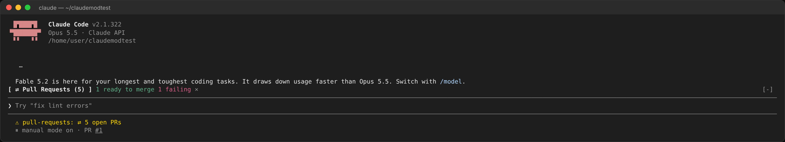
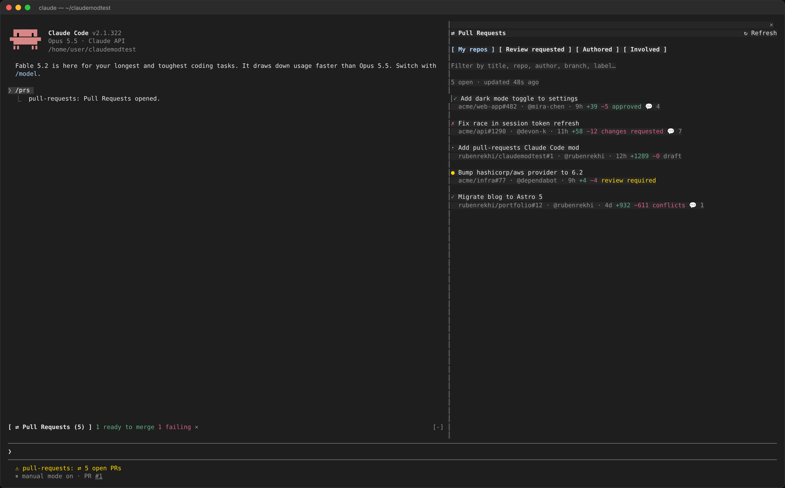
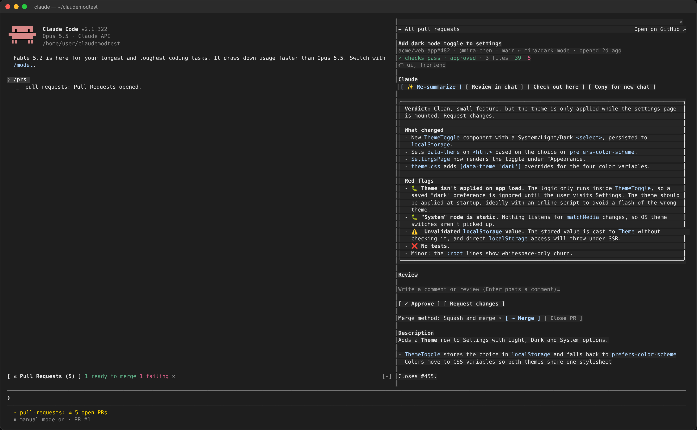
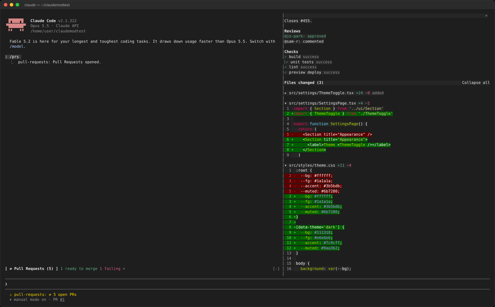
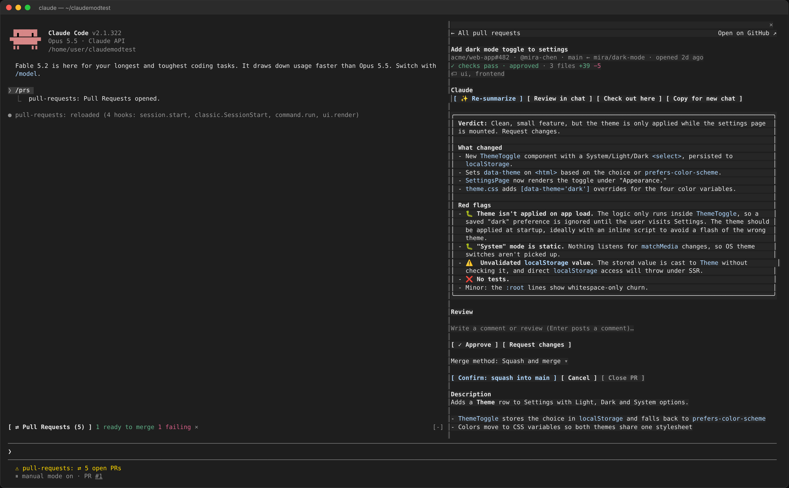

# pull-requests: a Claude Code mod

A **Pull Requests** page inside Claude Code (desktop Code tab and terminal): all your open PRs across GitHub, with review, diffs, merging and Claude built in.

## Opening it

- The **⇄ Pull Requests (N)** button above the prompt (it also shows how many are ready to merge or failing; `×` hides it for the session)
- `/prs` (works even while Claude is mid-turn), or `/prs review|authored|involved|repos` to jump to a tab, or `/prs refresh` to re-read your GitHub login
- The status line shows the open count; the list refreshes every 5 minutes and toasts when a new PR shows up

Mods can't add items to the Desktop app's own sidebar: they draw in a pane, the band above the prompt, toasts, the status line and Claude Code's own rows (see [Draw in the interface](https://code.claude.com/docs/en/plugins/mods/interface)). The page opens as a pane docked beside the chat.

## Screenshots

Taken in a real Claude Code terminal session (v2.1.322) running this mod. The pull requests are sample data served by a stand-in GitHub API; Claude's summary was generated live from the sample diff.

**The entry point:** a button above the prompt, with the open count in the status line.



**The page:** every open PR, with checks, review state, size and conflicts at a glance.



**A pull request:** Claude's summary, review and merge actions, the description, reviews and checks.



**Files changed:** each file expands into a syntax-highlighted diff.



**Merging** takes a second press to confirm.



## The page

**List:** tabs for *My repos* (every open PR on repos you own), *Review requested*, *Authored* and *Involved*, plus a live filter over title, repo, author, branch and label. Each row shows CI (✓ ✗ ●), review state, +/−, draft, conflicts and comment count.

**A PR:**
- **Claude:** ✨ *Summarize* (Claude reads the diff and writes a verdict and red flags right in the pane), *Review in chat*, *Fix failing CI* (shown when checks fail), *Check out here*, *Copy for new chat* (copies a review prompt you can paste into a new session)
- **Review:** comment (Enter), Approve, Request changes, Ready for review (drafts), Update branch (when behind or conflicting)
- **Merge:** pick squash, merge or rebase, then press twice to confirm. Close PR also asks for a second press.
- Description, latest review per reviewer, every check run (linked), and the files changed, each expandable to a coloured inline diff

## GitHub access

The mod uses `GITHUB_TOKEN` / `GH_TOKEN` if set. Otherwise it uses the GitHub CLI's login (`gh auth token`, looked up on PATH, `/opt/homebrew/bin`, `/usr/local/bin` and `/usr/bin`). Run `gh auth login` once and it works. For GitHub Enterprise, set `GITHUB_API_URL` (for example `https://ghe.example.com/api/v3`).

## Install

Copy this folder anywhere, then either:

- terminal: `claude --plugin-dir /path/to/pull-requests`
- desktop app (or any host where you can't pass flags): add it to `~/.claude/settings.json`
  ```json
  { "env": { "CLAUDE_CODE_PLUGIN_DIRS": "/path/to/pull-requests" } }
  ```

Check it with `claude plugin validate <folder>` and `claude plugin test <folder>`.
